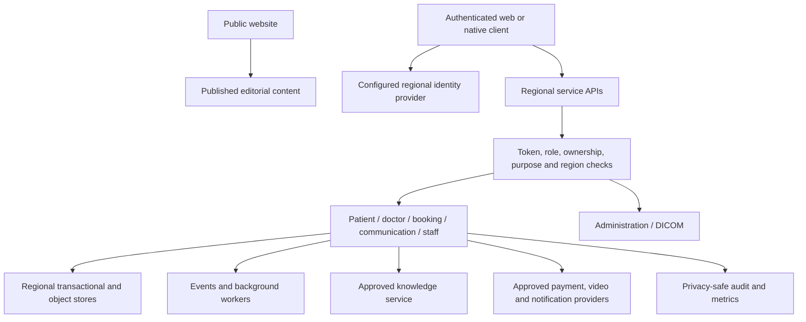

# Platform architecture

Reviewed 2026-10-13. Delivery state is recorded in [release status](RELEASE-STATUS.md); the cell architecture in [scalability](SCALABILITY.md) is a future deployment design.

## Product and roles

MediConnect coordinates care access, appointment and billing state, clinical information, communication and public health content. Authorization distinguishes patients, practitioners, clinic staff and administrators. Pharmacy-related actions belong to explicit backend permissions and workflow contracts; a navigation link alone grants no access.

| Role | Main responsibilities | Boundary |
|---|---|---|
| Patient | Own profile, appointments, consent, records, communications and billing | Own resources and approved care relationships |
| Practitioner | Schedule, clinical context, prescriptions, referrals and consultation | Verified role, relationship, purpose and region |
| Clinic staff | Shifts, tasks, announcements and directory | Staff permissions; no inherited clinical/admin privilege |
| Administrator | User operations, audit and platform health | Explicit permissions and audited actions; no unrestricted patient-data bypass |

## Components

This diagram describes service relationships. Each provider and route needs its own activation and operating acceptance; no third-party service is activated by drawing it here.

## Seven backend domains

| Service | Source stack | Responsibility |
|---|---|---|
| Patient | Node.js/TypeScript | Registration, own profile, vitals, allergies, immunizations, care plans, patient matching, consent, export and erasure |
| Doctor | Node.js/TypeScript | Practitioner data, EHR, prescribing, terminology, labs, referrals, medication reconciliation and clinical access |
| Booking | Node.js/TypeScript | Appointment lifecycle, conflict/idempotency handling, billing, subscriptions, insurance and calendar coordination |
| Communication | Node.js/TypeScript | Messaging, real-time access, consultation coordination and AI routing |
| Staff | Node.js/TypeScript | Staff shifts, tasks, announcements and directory |
| Administration | Python/FastAPI | Administrative operations, audit, health and analytics |
| DICOM | Python/FastAPI | Imaging validation, de-identification, storage/PACS and FHIR imaging references |

FHIR R4, HL7, SMART on FHIR, CDS Hooks and DICOM are interoperability contracts in the retained implementation. Partner conformance, clinical terminology licensing and production exchange require separate verification.

## Request and data path

1. The client obtains the current session through its authentication SDK.
2. The web API boundary selects the configured service family and region and applies cancellation/deadline handling.
3. The server verifies token signature/issuer/audience/expiry, authorization and resource ownership, then validates the request.
4. Regional context is checked against trusted account/resource context. A request header cannot independently change the patient's data region.
5. Sensitive data uses shared encryption and privacy-safe audit helpers. Side effects use the domain's idempotency/event contract.
6. Errors return bounded, actionable responses; provider failure does not become an apparent successful write or clinical answer.

See [API contracts](API-CONTRACTS.md) for route families, retries, uploads and real-time requirements.

## Public website and CMS

The public application serves maintained content and CMS articles without requiring an account. Authentication dependencies are loaded only when a protected request needs them. Public CMS reads carry no account bearer token or account cookie, and media URLs are validated against the configured CMS origin and upload path.

The existing-host CMS release uses Strapi, a durable database mount and durable upload storage. Public readers and editors have different permissions. Complete media recovery and an application-consistent off-host restore remain operational gates.

## Knowledge service

The isolated local-model release has separate medical and codebase stores, accounts, API keys and signing secrets. Each RAG service joins only its own internal network; Ollama joins both. A credential-free ingress proxy exposes the authenticated services only on host loopback. Dynamic DNS and separate subnets protect workspace routing during replacement.

The reviewed runtime enforces local provider origins, embedding deadlines, bounded resources and privacy-safe Python logging. The optional multimodal document CLI has separate provider/configuration and approval requirements. Retrieval quality, source grounding, clinical review and end-to-end application integration are additional gates.

## Decisions and tradeoffs

| Decision | Reason and consequence |
|---|---|
| Separate public and authenticated entry paths | Public content can remain available while account/provider services are unavailable |
| Regional data planes | Supports residency and transfer obligations; every dependent store, worker and provider must follow the same policy |
| Domain services and shared security helpers | Limits service responsibility while keeping authorization, encryption, configuration and audit behavior consistent |
| Typed configuration and maintained content files | Provider/model/endpoint/limit changes do not require business-logic edits |
| Immutable, local-first releases | Produces reproducible artifacts and auditable source/live parity; deployment is a verification step |
| Measured regional cells for future scale | Limits failure impact and growth per cell; requires routing, quotas, operating ownership and load evidence |

## Future growth

The existing VPS footprint serves the current scoped application needs. Reaching 1M+ simultaneous users requires the independently sized edge, identity, API, data, real-time, media and AI capacity in [SCALABILITY.md](SCALABILITY.md), together with the operating controls in [RELIABILITY.md](RELIABILITY.md).
