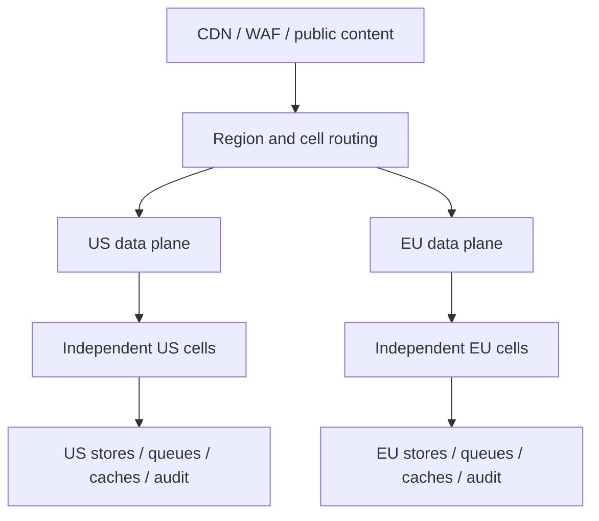

# Capacity roadmap: 1,000,000+ simultaneous users

Reviewed 2026-10-13 · Future engineering objective. Capacity is accepted only for a measured release, configuration, workload and failure envelope.

## Define the workload

The target is **at least one million concurrent users**, not one million accounts or monthly visitors. Define the observation interval, connected-session lifetime, active interactions and regional split before sizing infrastructure.

| Measurement | Required definition |
|---|---|
| Registered accounts and monthly active users | Identity/storage/support demand; counted separately from concurrency |
| Concurrent sessions | Open sessions at the same instant; include session duration and reconnect behavior |
| Active API traffic | Endpoint mix, requests per session, read/write ratio, payload sizes and burst distribution |
| Real-time traffic | Connections, messages per second, room size, fan-out and reconnect storms |
| Media traffic | Consultation participants/minutes, bitrate and provider quotas |
| AI traffic | Questions per second, retrieved context, generated tokens, queue depth and inference latency |
| Regional/tenant distribution | US/EU split, large clinics, popular practitioners and skewed partition keys |

A starting session allocation for planning is below. The shares total 100%; they must be replaced or confirmed using measured demand. A user's primary activity category is counted once, while secondary API/media actions are measured separately.

| Primary session activity | Planning share | Principal capacity |
|---|---|---|
| Public content and discovery | 60% | CDN requests, cache misses and CMS publication refresh |
| Authenticated dashboards and own records | 25% | Identity refresh, authorized API reads and regional data |
| Messaging/waiting room | 7% | Long-lived connections and message fan-out |
| Appointment/billing actions | 4% | Transactional writes, conflicts and provider events |
| Consultation | 3% | Media participants and connection establishment |
| Knowledge assistance | 1% | Bounded retrieval/inference workers and queues |

## Demand arithmetic

For each endpoint family, derive request demand from active users and interaction frequency. Convert public edge traffic to origin demand using measured cache behavior; never cache authenticated health data in a shared public cache.

`requests/second = active users × requests per user per minute ÷ 60`

`in-flight operations = arrival rate × mean operation time`

The checked-in [capacity input](../architecture/capacity-plan.example.json) is a separate API demand envelope: 1,000,000 users at six requests/minute gives 100,000 requests/second; its 1.5 headroom factor gives 150,000. Session mix and per-service request fractions are different quantities and must not be substituted for one another.

```bash
node scripts/capacity-plan.mjs architecture/capacity-plan.example.json
```

The offline calculator exits with status 2 while per-replica throughput is missing, leaves replica estimates unset and provisions no resources. Supply measured sustainable throughput at the required latency/error budget before using replica arithmetic. A calculated replica count alone does not prove capacity.

## Target deployment: regional cells



Each cell has an explicitly measured maximum workload and contains bounded API, worker, connection, cache and queue capacity. Account/tenant placement is stable inside its authorized region. Expansion adds tested cells and reserves enough capacity for a cell or zone failure; it does not depend on a universal users-per-cell assumption.

Cell routing, quotas, orchestration and multi-zone failure behavior are future operating work. The current isolated VPS knowledge footprint is not the million-user serving tier.

## Scale each layer

| Layer | Required design | Validation and limiting metric |
|---|---|---|
| Edge/content | Cache public immutable assets; bounded publication invalidation and origin protection | Hit ratio, origin RPS, cache stampedes, invalidation lag and regional user latency |
| Identity | Local JWT verification with bounded key caching; distinct sign-in/refresh quotas | Sign-in bursts, refresh synchronization, key rotation, revocation and provider limits |
| API | Stateless workers, bounded connection pools, horizontal scaling and admission control | Sustainable per-replica RPS at p95/p99 latency, CPU/memory, bootstrap and dependency limits |
| Real-time | Dedicated connection workers, drain/reconnect controls and tenant-aware fan-out | Connections/worker, messages/second, memory/connection and reconnect storms |
| Transactional data | High-cardinality ownership/region keys, conditional writes and paginated access | Item size/consistency cost, hot keys, conflict rates, throttling and lock contention |
| Cache/search | Tenant/region-safe keys, coalesced fills, expiry jitter and searchable indexes | Hit ratio, stale reads, eviction, index freshness and privacy isolation |
| Background work | Durable queues, idempotent consumers, bounded retries and dead-letter handling | Oldest queue age, lag, duplicate processing, retry storms and recovery throughput |
| Payments | Provider idempotency, signed/replay-safe events, reconciliation and controlled refunds | Sandbox lost-reply/duplicate/reordered-event tests and provider request quotas |
| Files/imaging | Authorized direct upload, quarantine/scanning and asynchronous processing | Size limits, upload rates, object access, scan backlog and malware/de-identification gates |
| Video | Separate approved media plane and short-lived authorized join grants | Participant concurrency, reconnects, regional handling, bandwidth and participant-minute cost |
| Knowledge/AI | Independent retrieval/inference workers, bounded queues and per-tenant fairness | Context/token budgets, model memory, throughput/latency, grounding, refusal and queue saturation |

Use [official DynamoDB partition guidance](https://docs.aws.amazon.com/amazondynamodb/latest/developerguide/bp-partition-key-design.html) when sizing data access; item size and consistency change capacity consumption. Do not translate capacity units directly into arbitrary application request rates.

## Progressive proof

| Milestone | Exercise | Acceptance |
|---|---|---|
| Service baseline | Each endpoint and background worker under controlled concurrency | Repeatable throughput, p95/p99, memory/CPU, validation and privacy results |
| 1,000 concurrent | Full journey mix with controlled data | Auth/ownership/region correctness, no duplicate mutations and bounded queues |
| 10,000 concurrent | Identity refresh, connections and skewed practitioner demand | SLOs held; throttling, dependency quotas and admission behavior verified |
| 100,000 concurrent | Complete regional cell and cell-router expansion | Measured cell limit, no cross-tenant/region access and safe canary/rollback |
| 1,000,000+ concurrent | Multiple cells and independent load generators; at least four-hour soak | Journey SLOs, stable memory, bounded lag, no lost/duplicate transactions and recorded cost |
| Failure envelope | Zone/cell/cache/identity/media/AI loss at target demand | Critical journeys protected, regional handling preserved and recovery objectives met |

Planning latency objectives for API benchmarks are p95 below 300 ms and p99 below 800 ms for endpoints whose workload permits them; journey-specific objectives in [reliability](RELIABILITY.md) govern actual acceptance. Record payload distribution and provider latency rather than hiding slow journeys inside an aggregate.

## Cost, quotas and operating ownership

Before provisioning or a large load test, produce a priced plan from current provider pricing and verified account allowances. Include compute, storage, transfer, identity, media, notifications, AI, observability and the load generators. Set hard budgets and a stop procedure, obtain explicit approval, and test the generator's own capacity.

No quota increase, paid inference, scale-out deployment or cloud creation is authorized by this document. Prioritize correctness and recovery before higher traffic. See the [roadmap](ROADMAP.md) and [AWS scalability testing guidance](https://docs.aws.amazon.com/wellarchitected/latest/framework/rel_testing_resiliency_test_non_functional.html).
